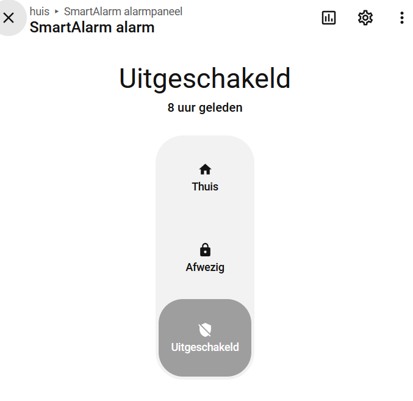
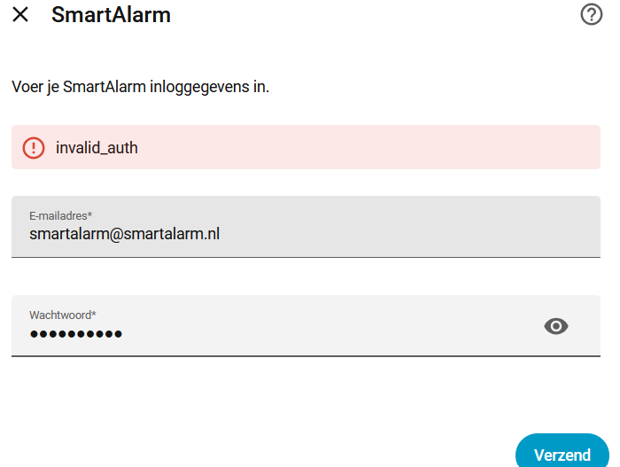
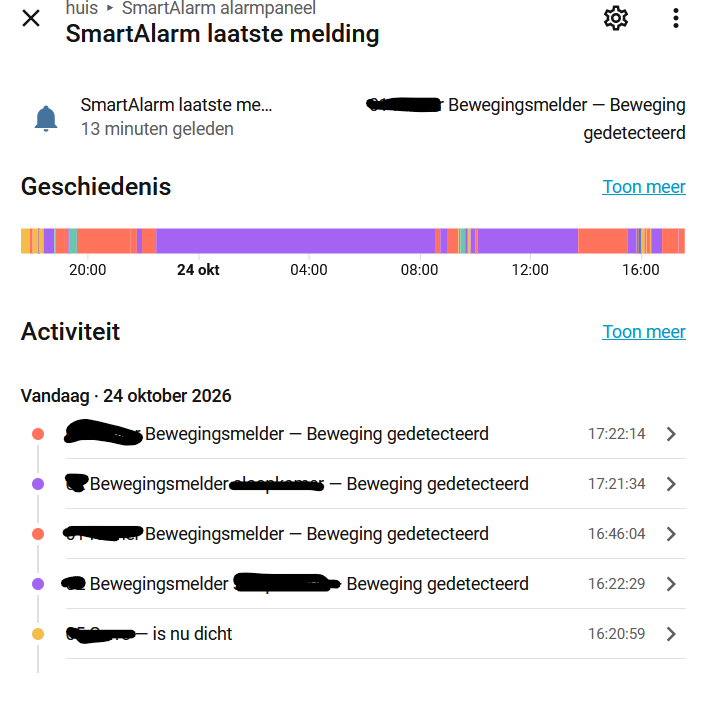
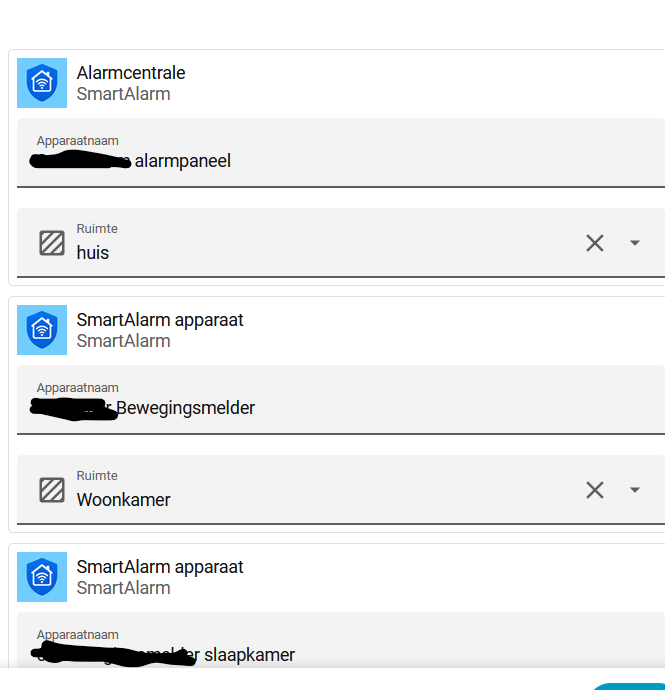
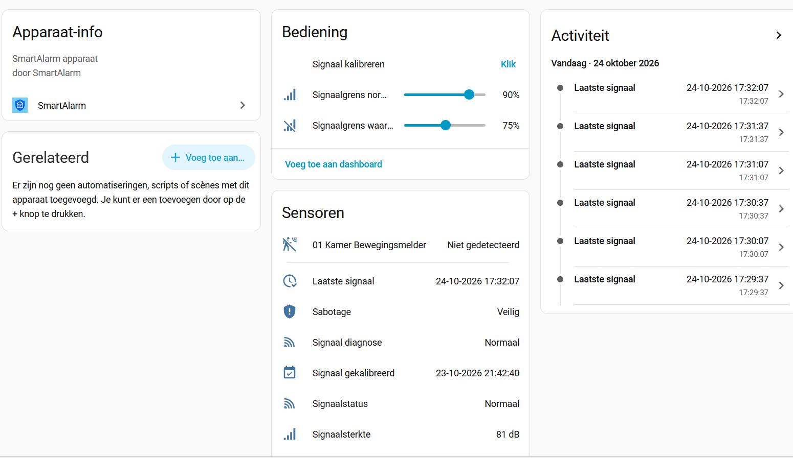

# SmartAlarm Home Assistant Integration

An independent community integration for connecting your SmartAlarm security system to Home Assistant.

**Current version: 0.4.15**

[🇳🇱 Nederlands](#-nederlands) | [🇬🇧 English](#-english)

---

## 🇳🇱 Nederlands

Met deze integratie kun je het SmartAlarm-alarmsysteem vanuit Home Assistant bedienen. De alarmcentrale ondersteunt de standen **aan**, **thuis** en **uit**.

Afzonderlijke ondersteunde SmartAlarm-apparaten worden als Home Assistant-entiteiten aangeboden. Daardoor kun je sensoren gebruiken in automatiseringen, meldingen en dashboards.

### Waarom deze integratie?

SmartAlarm is een Nederlands alarmsysteem. Deze integratie is oorspronkelijk ontwikkeld om het eigen SmartAlarm-systeem uitgebreider in Home Assistant te kunnen gebruiken.

Andere koppelmethoden, bijvoorbeeld via IFTTT, IMAP of Olisto, kunnen omslachtig zijn of bieden niet altijd directe toegang tot afzonderlijke sensoren. Deze integratie richt zich op de alarmcentrale en individuele SmartAlarm-apparaten.

### Functionaliteit

Afhankelijk van de apparaten en gegevens die SmartAlarm beschikbaar stelt, biedt de integratie onder meer:

- Bediening van de alarmcentrale: aan, thuis en uit.
- Afzonderlijke entiteiten voor ondersteunde SmartAlarm-apparaten.
- Statussen van deur-, raam- en bewegingsmelders.
- Ondersteuning voor rook-, hitte- en CO-melders.
- Inbraak-, sabotage-, brand- en CO-gerelateerde statussen en meldingen, voor zover beschikbaar via SmartAlarm.
- Signaalsterkte en signaaldiagnose.
- Handmatige signaalkalibratie per sensor.
- Instelbare signaalgrenzen.
- Een logische brandalarmstatus.
- Lokale opslag van relevante recente gebeurtenissen.

### Schermafbeeldingen

**SmartAlarm alarmpaneel**

**Voorbeeld van onjuiste inloggegevens**

**Melding op het paneel**

**Sensorconfiguratie**

**Sensorinformatie**

### Inloggen en account

Voeg SmartAlarm toe via **Instellingen → Apparaten en diensten → Integratie toevoegen → SmartAlarm**. Vul het e-mailadres en wachtwoord van je SmartAlarm-account in.

De integratie meldt zich aan via de SmartAlarm-webomgeving en gebruikt de verkregen sessie voor de API-communicatie. Gebruik je normale SmartAlarm-inloggegevens; deel deze niet in openbare meldingen of logbestanden.

- Bij onjuiste inloggegevens wordt de configuratie niet voltooid. Controleer je accountgegevens en probeer opnieuw.
- Als SmartAlarm een sessie niet meer accepteert, probeert de integratie opnieuw in te loggen.
- Als SmartAlarm de inloggegevens afwijst, kan Home Assistant vragen de integratie opnieuw te authenticeren. Volg dan de herauthenticatiestap en voer het wachtwoord opnieuw in.

De integratie is afhankelijk van de SmartAlarm-webomgeving en API. Wijzigingen daarin kunnen invloed hebben op de werking.

### Installatie via HACS

Zodra de betreffende versie beschikbaar is via HACS:

1. Open HACS in Home Assistant.
2. Ga naar **Integraties**.
3. Zoek naar **SmartAlarm**.
4. Installeer de beschikbare versie.
5. Herstart Home Assistant als HACS daarom vraagt of na de installatie.
6. Ga naar **Instellingen → Apparaten en diensten**.
7. Kies **Integratie toevoegen**, zoek SmartAlarm en voer je accountgegevens in.

Als SmartAlarm nog niet in de standaardlijst staat, kan de repository eventueel als aangepaste repository worden toegevoegd, voor zover HACS dat toestaat.

### Handmatige installatie

1. Download de gewenste release van GitHub.
2. Kopieer de map `custom_components/smartalarm` uit de release naar `/config/custom_components/`.
3. Controleer dat de bestanden in `/config/custom_components/smartalarm/` staan.
4. Herstart Home Assistant.
5. Voeg SmartAlarm toe via **Instellingen → Apparaten en diensten**.

### SmartAlarm-gebruiker voor Home Assistant

Aanbevolen: Maak een aparte SmartAlarm-gebruiker aan voor Home Assistant.

Een gewone SmartAlarm-gebruiker kan het alarm inschakelen, uitschakelen en op de thuismodus zetten. Beheerdersrechten zijn hiervoor niet nodig.

Alleen een beheerder kan SmartAlarm-gebruikers aanmaken, wijzigen of verwijderen.

Met een aparte gebruiker zijn alarmhandelingen vanuit Home Assistant gemakkelijker herkenbaar in de activiteitenhistorie van SmartAlarm, voor zover deze daarin worden weergegeven.

Maak de gebruiker aan in SmartAlarm en gebruik de bijbehorende inloggegevens bij het configureren van de Home Assistant-integratie.

### Signaalsterkte en kalibratie

Iedere sensor heeft een eigen positie, afstand, bouwmaterialen en lokale omstandigheden. Daarom kan de normale signaalsterkte per sensor verschillen.

Met handmatige kalibratie worden geldige metingen verzameld om voor die sensor een referentiewaarde vast te stellen. Deze referentie is de persoonlijke nulmeting van de sensor; het is **geen absolute RSSI-waarde van 0 dB**. De referentie geeft het normale ontvangstniveau op de locatie van die sensor weer.

De signaalinformatie en ingestelde grenzen kunnen helpen om afwijkingen te herkennen. De meting is geen garantie dat een sensor altijd bereikbaar is of een alarm zal doorgeven.

### Brand, CO, batterij en sabotage

- Lage-batterijmeldingen zijn bedoeld als batterijwaarschuwing en horen niet als brand- of CO-alarm te worden geïnterpreteerd.
- Brand- en CO-alarmstatussen worden per melder bijgehouden.
- Sabotagestatus wordt per melder bijgehouden.
- Een expliciete herstelmelding kan de sabotagestatus van de betreffende melder wissen.
- Een afgeronde kalibratie kan eveneens herstel aangeven wanneer de betreffende sensor daarbij als veilig wordt bevestigd en de controles slagen.
- Het uitschakelen van de inbraakbeveiliging wist de brand- en CO-alarmstatussen volgens de integratielogica.

**Belangrijk:** deze integratie is een aanvullende koppeling en geen vervanging van de SmartAlarm-centrale, gecertificeerde alarmvoorzieningen of de voorgeschreven controles. Vertrouw voor brand-, CO- en inbraakveiligheid niet uitsluitend op Home Assistant of deze integratie.

### Gebeurtenissencache en herstart

De integratie bewaart lokaal een beperkte cache van relevante SmartAlarm-gebeurtenissen. Deze is bedoeld om recente gebeurtenisinformatie na een Home Assistant-herstart tijdelijk beschikbaar te houden. De cache bevat maximaal 200 relevante gebeurtenissen en vervangt de recorder- of geschiedenisfunctie van Home Assistant niet.

Bewegingsgebeurtenissen worden niet in deze permanente cache opgeslagen. Na een herstart kan opgeslagen informatie tijdelijk de laatst bekende status leveren terwijl de verbinding opnieuw tot stand komt. Zodra actuele apparaatstatus beschikbaar is, krijgt die voorrang.

### Problemen oplossen

Als de integratie niet verschijnt:

1. Controleer of de bestanden in `/config/custom_components/smartalarm/` staan.
2. Herstart Home Assistant.
3. Controleer **Instellingen → Apparaten en diensten**.
4. Bekijk de Home Assistant-logboeken op SmartAlarm-fouten.

Bij een loginprobleem: controleer de accountgegevens en of aanmelden via de SmartAlarm-webomgeving lukt. Bij een melding over herauthenticatie: volg de herauthenticatiestap in Home Assistant.

Toont een sensor direct na een herstart een onverwachte status, wacht dan tot de verbinding de actuele apparaatstatus heeft bijgewerkt. Blijft het probleem bestaan, maak dan een issue aan met relevante foutmeldingen; verwijder wachtwoorden en andere privégegevens.

### Ontwikkeling en testen

Versie 0.4.15 is getest met drie SmartAlarm-accounts. Bedienen van het alarm is op een productie- en testinstallatie van Home Assistant gecontroleerd, met verschillende SmartAlarm-accounts voor dezelfde basis. Ook zijn onder meer herstart, sensorinformatie en behoud van kalibratiegegevens gecontroleerd.

Dit beschrijft de uitgevoerde praktijktests en is geen garantie voor elke SmartAlarm-configuratie of toekomstige API-wijziging. Gebruik bij voorkeur een gepubliceerde release op productie.

### Disclaimer

Dit is een onafhankelijke, community-ontwikkelde Home Assistant-integratie. Het is geen officieel product van SmartAlarm. Gebruik is op eigen risico. De beschikbaarheid en werking van de SmartAlarm API kunnen zonder voorafgaande kennisgeving veranderen.

### Licentie

Raadpleeg het LICENSE-bestand in deze repository voor de licentievoorwaarden.

---

## 🇬🇧 English

This integration connects your SmartAlarm security system to Home Assistant. The alarm panel supports **armed**, **home** and **disarmed** modes.

Individual supported SmartAlarm devices are exposed as Home Assistant entities and can be used in automations, notifications and dashboards.

### Why this integration?

SmartAlarm is a Dutch security system. This integration was originally developed to make more extensive use of a personal SmartAlarm installation in Home Assistant.

Other connection methods, such as IFTTT, IMAP or Olisto, may be cumbersome or may not provide direct access to individual sensors. This integration focuses on exposing the alarm panel and individual SmartAlarm devices.

### Features

Depending on the installed devices and the information made available by SmartAlarm, the integration provides:

- Alarm panel control: armed, home and disarmed.
- Individual entities for supported SmartAlarm devices.
- Door, window and motion sensor states.
- Support for smoke, heat and CO detectors.
- Burglary, tamper, fire and CO-related states and notifications, where provided by SmartAlarm.
- Signal strength monitoring and diagnostics.
- Manual signal calibration per sensor.
- Configurable signal thresholds.
- A logical fire-alarm status.
- Local storage of relevant recent events.

### Screenshots

**SmartAlarm alarm panel**

**Example of invalid login credentials**

**Panel message**

**Sensor configuration**

**Sensor information**

### Login and account

Add SmartAlarm through **Settings → Devices & services → Add integration → SmartAlarm**. Enter the email address and password of your SmartAlarm account.

The integration signs in through the SmartAlarm web interface and uses the resulting session for API communication. Use your regular SmartAlarm credentials. Do not share them in public reports or logs.

- If the credentials are rejected, setup cannot be completed. Check your account details and try again.
- If SmartAlarm no longer accepts a session, the integration attempts to sign in again.
- If SmartAlarm rejects the credentials, Home Assistant may require reauthentication. Follow the reauthentication flow and enter the password again.

The integration depends on the SmartAlarm web interface and API. Changes to either may affect operation.

### Installation via HACS

Once the relevant release is available through HACS:

1. Open HACS in Home Assistant.
2. Go to **Integrations**.
3. Search for **SmartAlarm**.
4. Install the available version.
5. Restart Home Assistant if requested by HACS or after installation.
6. Go to **Settings → Devices & services**.
7. Select **Add integration**, search for SmartAlarm and enter your account credentials.

If SmartAlarm is not yet listed in the default repository, the repository may be added as a custom repository if supported by HACS.

### Manual installation

1. Download the desired GitHub release.
2. Copy the `custom_components/smartalarm` directory from the release to `/config/custom_components/`.
3. Confirm that the files are located in `/config/custom_components/smartalarm/`.
4. Restart Home Assistant.
5. Add SmartAlarm through **Settings → Devices & services**.

### SmartAlarm user for Home Assistant

Recommended: Create a dedicated SmartAlarm user for Home Assistant.

A regular SmartAlarm user is sufficient to arm, disarm and switch the alarm to home mode. Administrator permissions are not required for Home Assistant.

Only an administrator can create, edit or remove SmartAlarm users.

Using a separate user makes Home Assistant alarm operations easier to identify in the SmartAlarm activity history, where supported.

Create the user in SmartAlarm and use its credentials when configuring the Home Assistant integration.

### Signal strength and calibration

Each sensor has its own location, distance, building materials and environmental conditions. Normal signal strength can therefore vary between sensors.

Manual calibration collects valid measurements to establish a reference for that sensor. This is the sensor's own baseline; it is **not an absolute RSSI value of 0 dB**. It represents the normal reception level at that sensor's location.

Signal information and configurable thresholds can help identify changes. They cannot guarantee that a sensor will always be reachable or that an alarm will be delivered.

### Fire, CO, battery and tamper

- Low-battery notifications are battery warnings and should not be interpreted as fire or CO alarms.
- Fire and CO alarm states are tracked separately for each detector.
- Tamper state is tracked per detector.
- An explicit recovery message can clear the tamper state of the corresponding detector.
- A completed calibration can also indicate recovery when the same detector is confirmed safe and the checks succeed.
- Disarming the intrusion system clears fire and CO alarm states according to the integration logic.

**Important:** this integration is an additional connection, not a replacement for the SmartAlarm panel, certified alarm equipment or required checks. Do not rely solely on Home Assistant or this integration for fire, CO or intrusion safety.

### Event cache and restart

The integration maintains a limited local cache of relevant SmartAlarm events to make recent event information temporarily available after a Home Assistant restart. The cache holds up to 200 relevant events and is not a replacement for Home Assistant's recorder or history.

Motion events are excluded from this persistent cache. After restart, cached information may temporarily provide the last known state while the connection is restored. Once current device status is available, live status takes priority.

### Troubleshooting

If the integration does not appear:

1. Confirm that the files are located in `/config/custom_components/smartalarm/`.
2. Restart Home Assistant.
3. Check **Settings → Devices & services**.
4. Check the Home Assistant logs for SmartAlarm errors.

For login issues, verify your account details and check whether you can sign in through the SmartAlarm web interface. If Home Assistant requests reauthentication, follow that flow.

If a sensor displays an unexpected state immediately after restart, allow time for the integration to synchronize current device status. If the problem persists, open an issue with relevant error messages, removing passwords and other private information.

### Development and testing

Version 0.4.15 has been tested with three SmartAlarm accounts. Alarm control was checked on production and test Home Assistant installations, using different SmartAlarm accounts connected to the same base. Restart behavior, sensor information and retention of calibration data were also checked.

This describes practical tests performed; it is not a guarantee for every SmartAlarm configuration or future API change. Prefer a published release for production.

### Disclaimer

This is an independent, community-developed Home Assistant integration. It is not an official SmartAlarm product. Use it at your own risk. SmartAlarm API availability and behavior may change without notice.

### License

Refer to the LICENSE file in this repository for the license terms.
